<div align="center">

<picture>
  <source media="(prefers-color-scheme: light)" srcset="docs/images/banner-light.webp">
  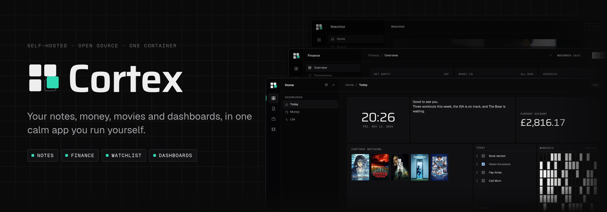
</picture>

<br>

[](https://github.com/Fergtato/cortex/actions/workflows/docker.yml) [](https://github.com/Fergtato/cortex/pkgs/container/cortex) [](LICENSE) [](tsconfig.base.json) [](docs/self-hosting.md)

**[Quick start](#quick-start)** · **[The apps](#the-apps)** · **[Everywhere](#everywhere)** · **[Self-hosting](#self-hosting)** · **[How it's built](#how-its-built)** · **[Development](#development)** · **[Roadmap](#roadmap)**

</div>

---

Cortex is a **self-hosted suite of personal apps** for tracking your life:
**Notes** for pages and lists, **Finance** for money, **Watchlist** for movies
and TV, and **Home** for dashboards that pull them all together. It runs as
**one Docker container** with your data in **one volume**. There's no cloud
account, no subscription and no tracking. Your notes, bank imports and watch
history stay on your machine.

It's built as one modular app rather than a pile of separate services, so the
apps share one sign-in, one design system, one backup file and one set of
dashboards. Adding an app means adding a folder.

<picture>
  <source media="(prefers-color-scheme: light)" srcset="docs/images/home-light.webp">
  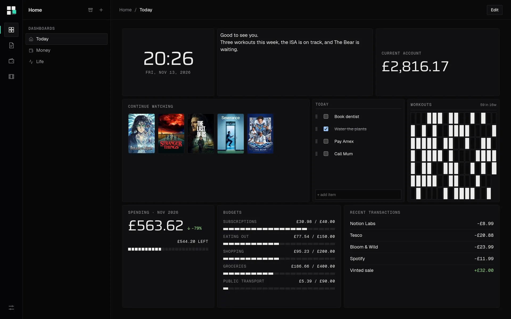
</picture>

## Why Cortex

- **One container, five minutes.** `docker run` with one volume, then create
  your account in the browser. SQLite by default, Postgres if you want it.
- **Apps that know about each other.** A dashboard can show your bank balance
  next to the show you're halfway through and the habit you're keeping.
- **Your data, portable.** One JSON backup covers every app. Import it into
  another Cortex, or keep it as an archive.
- **Calm, fast, keyboard-friendly.** An instrument-like design system with one
  accent colour, short linear motion, and themes you can swap or write yourself.
- **Works on your phone.** Every screen is responsive, with a bottom app bar on
  small screens.
- **Built to be hacked on.** TypeScript end to end, a documented module
  contract, and [AGENTS.md](AGENTS.md) for contributors, human or AI.

## Quick start

```bash
docker run -d --name cortex -p 8080:8080 -v cortex-data:/data ghcr.io/fergtato/cortex:latest
```

Open **http://localhost:8080** and create an account. **The first account
becomes the admin**, and sign-up then closes. Add other people in **Settings →
Users**.

<details>
<summary><b>Docker Compose</b></summary>

```yaml
services:
  cortex:
    image: ghcr.io/fergtato/cortex:latest
    ports:
      - "8080:8080"
    volumes:
      - cortex-data:/data
    environment:
      # All optional. See docs/self-hosting.md for the full list.
      - CORTEX_URL=https://cortex.example.com   # when behind a reverse proxy / HTTPS
      - TMDB_API_KEY=                           # or paste it in Settings → Watchlist
    restart: unless-stopped

volumes:
  cortex-data:
```

</details>

**Watchlist** needs a free [TMDB](https://www.themoviedb.org/settings/api) API
key. The admin pastes it once in **Settings → Watchlist** (it's stored
encrypted) or sets `TMDB_API_KEY`. Everything else works with no
configuration.

## The apps

<table>
  <tr>
    <td width="50%"><a href="#home-dashboards">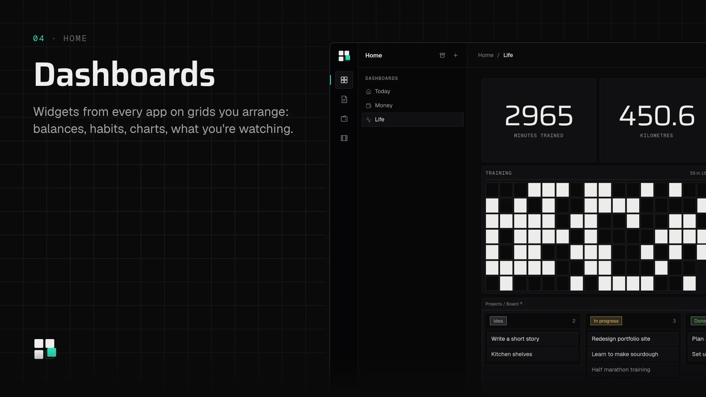</a></td>
    <td width="50%"><a href="#notes">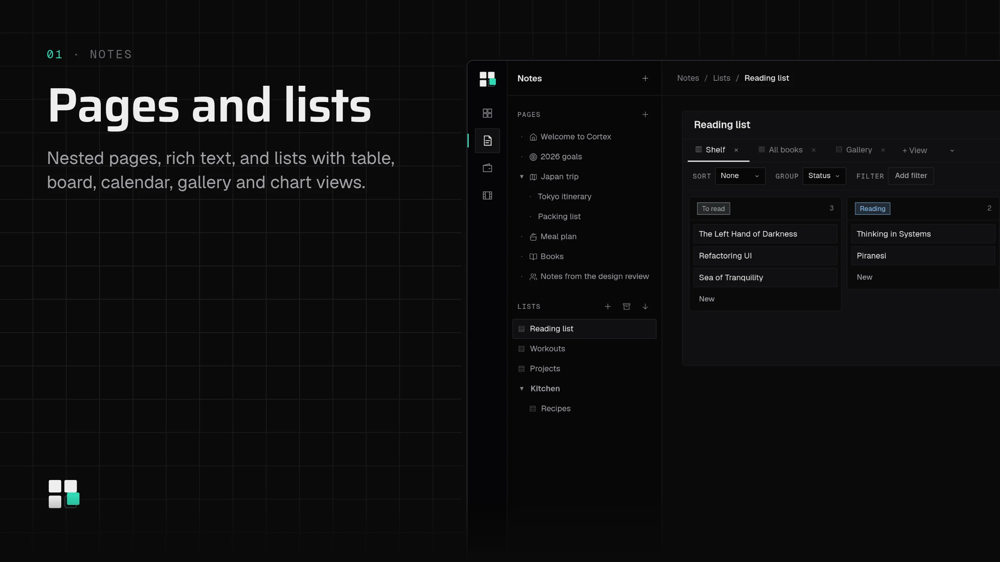</a></td>
  </tr>
  <tr>
    <td width="50%"><a href="#finance">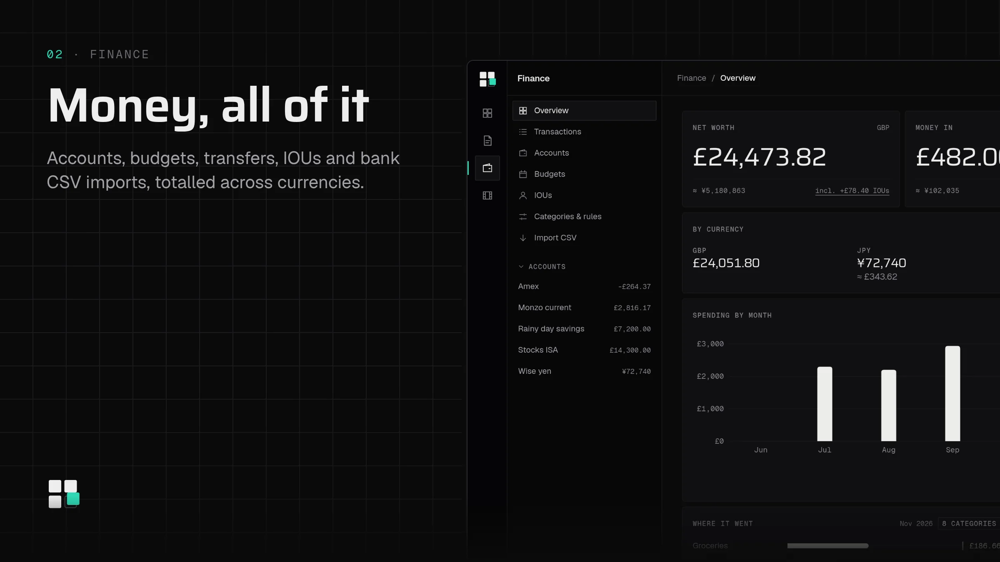</a></td>
    <td width="50%"><a href="#watchlist">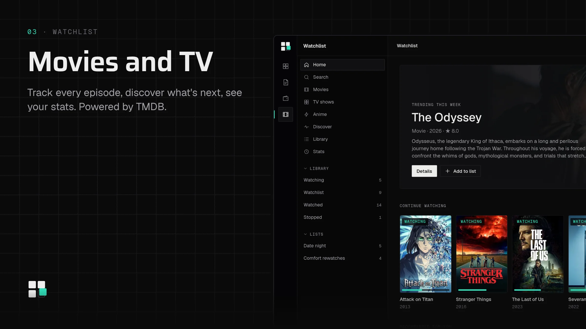</a></td>
  </tr>
</table>

### Home dashboards

Grids of widgets you arrange, from every app. Make as many dashboards as you
like, group them in folders, and switch each between **fit to screen** and
**scrolling**. On a phone they reflow into one column.

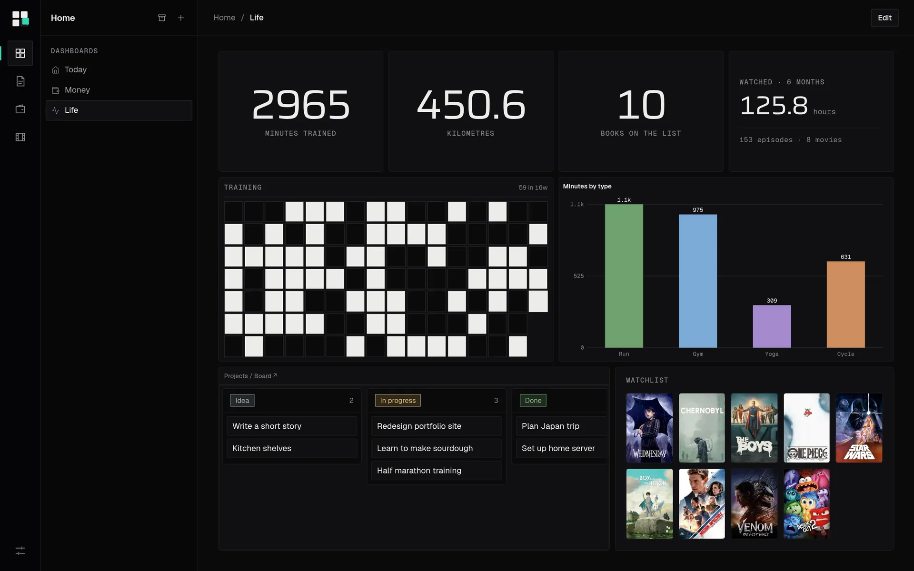

| From | Widgets |
| --- | --- |
| **Home** | Clock, text, timer, image, API metric and API panel (live JSON from any service through [Connections](#connections)), sci-fi telemetry |
| **Notes** | List view, checklist (simple or backed by a list), metric (count, sum or average of a column), habit tracker (a GitHub-style calendar), chart, quick-add form, action button |
| **Finance** | Balance or net worth, spending this month against budget, budgets, recent transactions, spending chart |
| **Watchlist** | Continue watching, watchlist queue, upcoming episodes, watch time |

Widgets are lazy-loaded, so a dashboard only downloads the code it shows.

### Notes

A fast, Notion-style workspace: nested **pages** with a rich-text editor, and
**lists** (databases) that you can view six ways and embed in any page.

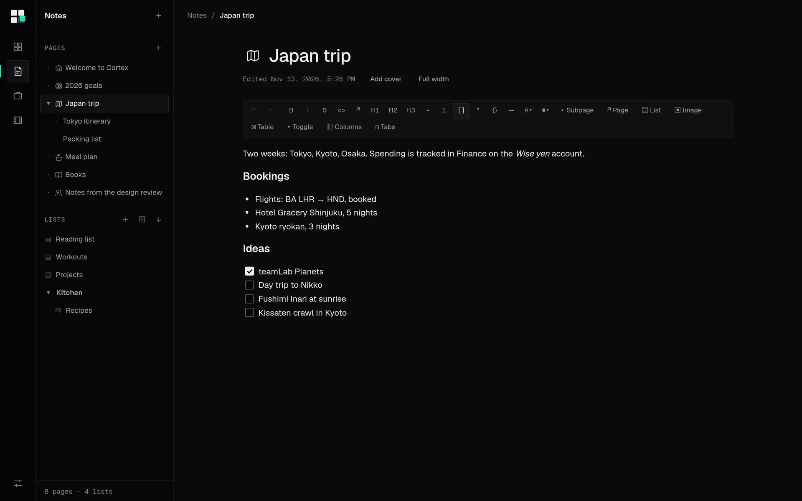

- **Editor**: headings, bold/italic/strike, inline code, colours and
  highlights, bullet/numbered/task lists, quotes, code blocks, tables,
  dividers, links, images you can resize, toggles, 2–5 columns and tabs.
- **Slash menu**: type `/` to insert any block, with fuzzy filtering and
  keyboard navigation.
- **Pages**: nest them as deep as you like, reorder by dragging, add icons
  (the full Lucide set, in nine colours) and covers, and make any page **full
  width**.
- **Lists**: text, number, select and multi-select (coloured options), date,
  checkbox, URL, image, **formula**, created and edited time, and auto-ID
  properties.
  - **Views**: table, board, calendar, gallery, timeline and chart. Each view
    keeps its own filters, sort, grouping and column calculations.
  - **Formulas**: a small, safe expression language (`{Price} * {Qty}`,
    `if(…)`, `concat(…)`), computed live, sortable and filterable.
  - **Import and export** as CSV or JSON, organised in folders.

<table>
  <tr>
    <td width="50%">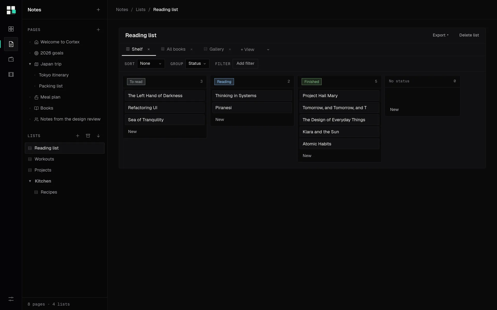</td>
    <td width="50%">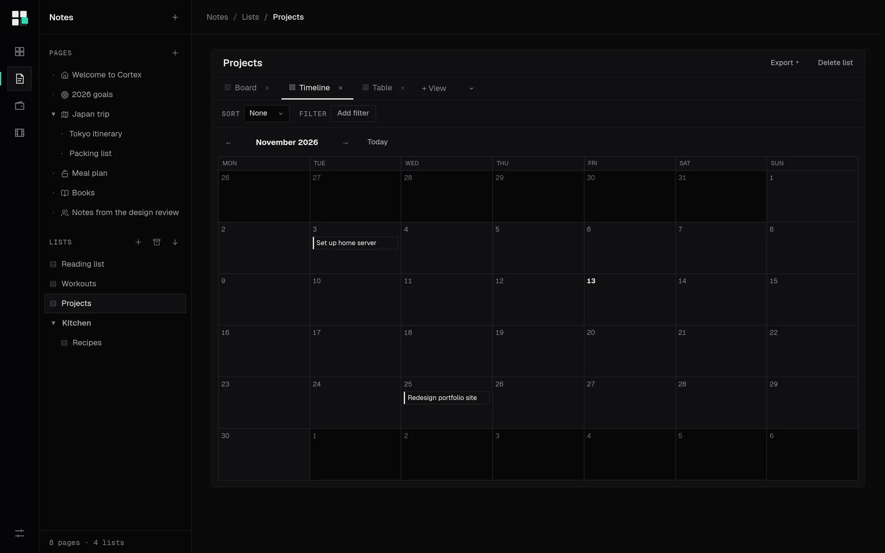</td>
  </tr>
  <tr>
    <td width="50%">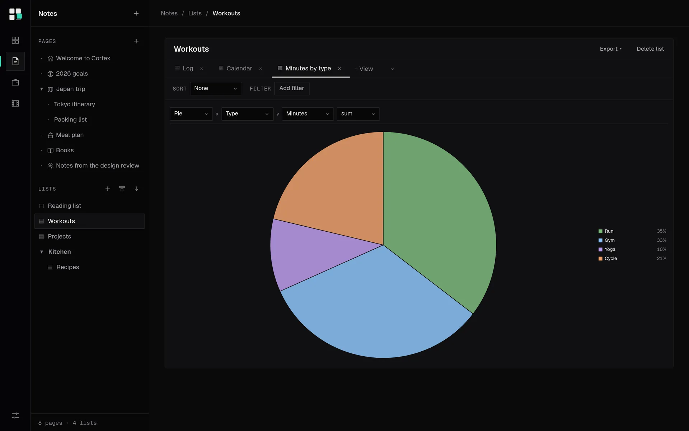</td>
    <td width="50%">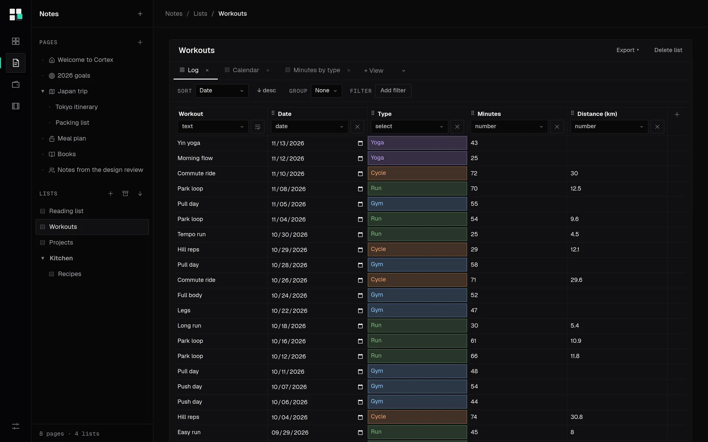</td>
  </tr>
</table>

### Finance

Accounts, budgets and spending that add up, including the awkward parts: money
moving between your own accounts, money friends owe you, and more than one
currency.

<picture>
  <source media="(prefers-color-scheme: light)" srcset="docs/images/finance-light.webp">
  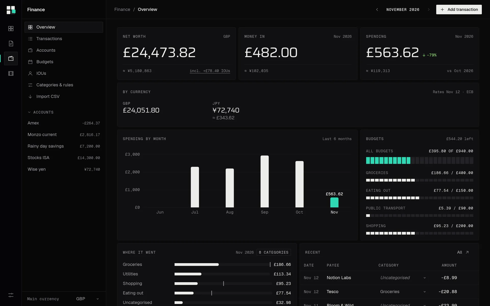
</picture>

- **Accounts** of every kind (current, savings, credit card, cash, investment,
  loan) in any currency. Money is stored as integer minor units, so totals are
  exact and yen, euros and dinars all round correctly.
- **Transactions** with categories, notes, search and filters. **Rules** file
  payees automatically ("Tesco" → Groceries) when you add or import them.
- **Budgets** per category, for every month or one month, with a running
  "left to spend".
- **Transfers between your accounts** don't count as income or spending.
  Cortex **spots likely pairs for you**, such as the same amount leaving one
  account and arriving in another within a few days, or a currency exchange,
  and asks you to confirm.
- **IOUs**: track who owes you and who you owe, by person. Outstanding IOUs
  count towards net worth, and repayments aren't counted as income.
- **Multiple currencies**: pick your main currency. Every total converts at
  today's ECB rates, with your other currencies shown alongside ("£24,473 ≈
  ¥5,180,863").

<table>
  <tr>
    <td width="50%">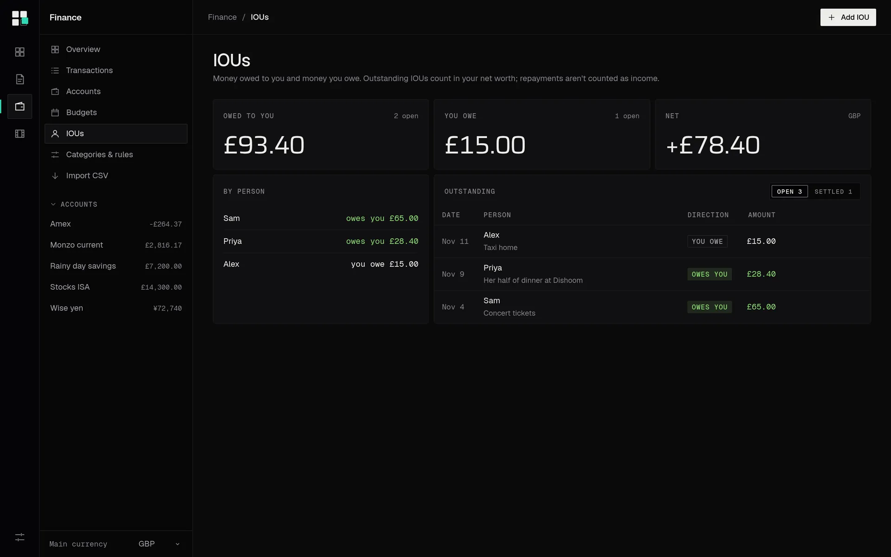</td>
    <td width="50%">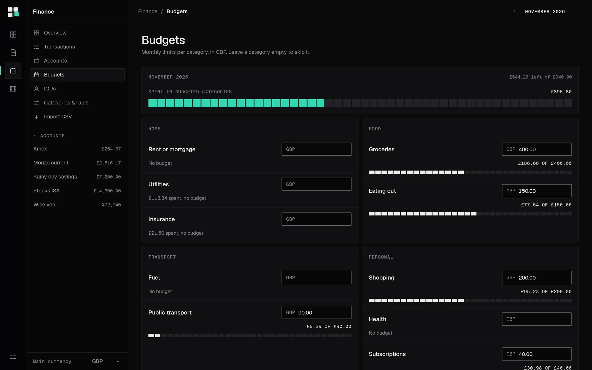</td>
  </tr>
</table>

#### Bank CSV import

Import a statement from any bank. Cortex shows **your file as it is**, with a
picker above each column for what it holds, then **exactly what will be
imported**: new rows, rows already in Cortex, and skipped rows with the reason.
Nothing is written until you press Import.

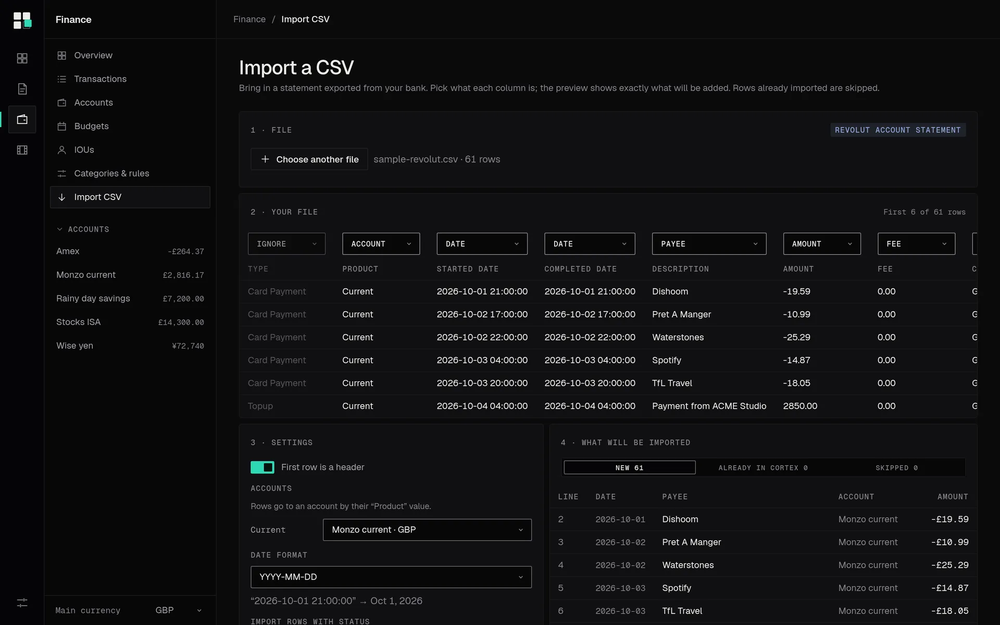

- **Recognises Revolut** account statements and savings-fund exports. One file
  can feed several accounts (Current, Savings…). Fees are subtracted and
  reverted payments skipped.
- **Balance column**: Cortex sets each account's balance to match the bank's
  latest figure, even with pending payments after it.
- **Never imports a row twice.** Re-import the same file, or an overlapping
  one, safely.
- **Dates and numbers** in any common format, including decimal commas,
  separate money-in and money-out columns, and flipped signs.
- **Hundreds of tiny daily rows**, such as savings interest, tax and fees, can
  be combined into one row per month.

### Watchlist

Movies and TV from [TMDB](https://www.themoviedb.org), tracked episode by
episode.

<picture>
  <source media="(prefers-color-scheme: light)" srcset="docs/images/watchlist-light.webp">
  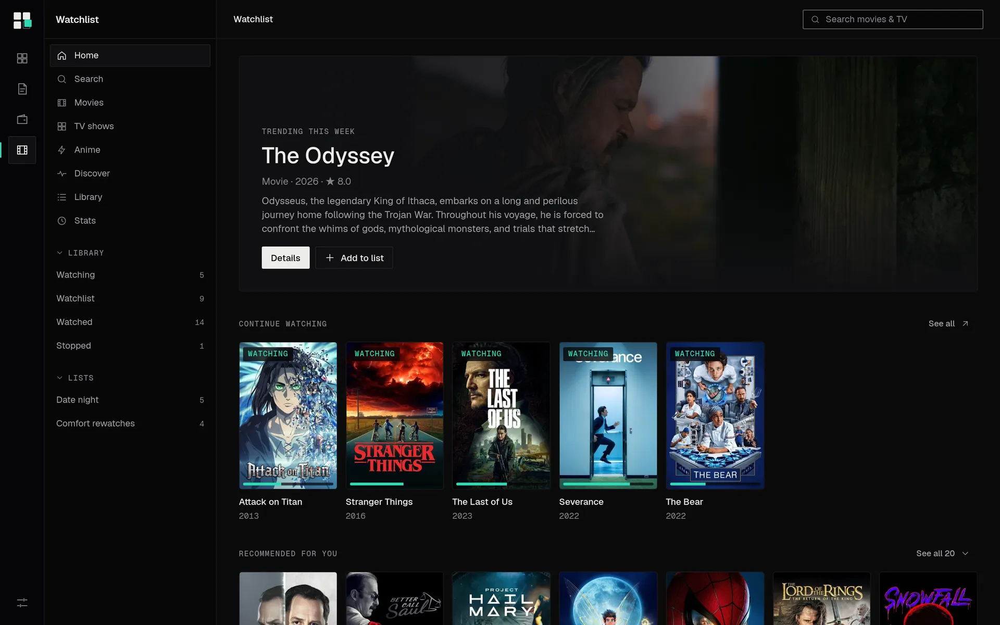
</picture>

- **One-click filing**: hover a poster for Watchlist, Watching and Watched
  buttons, plus a menu for your own lists.
- **Quick peek**: click a poster for the basics, status buttons and the
  trailer, without leaving the page.
- **Discover**: one title at a time. Skip it or file it with the buttons, the
  arrow keys, or by dragging the poster. Skipped titles don't come back.
- **TV tracking**: tick episodes one by one or a season at a time. Cortex
  offers to mark the earlier episodes you missed. Status follows along:
  watching, caught up (waiting for the next season), finished, or **Stopped**
  for shows you've given up on.
- **Stats**: hours watched this week, over six months, this year and all time,
  a 12-month chart, top genres and recent activity, for TV and movies
  separately.
- **Search that forgives typos**: live results as you type. Misspellings and
  missing spaces still find the title ("bladrunner" → Blade Runner).
- **Library** with shelves for Movies, TV and Anime, sortable seven ways,
  custom lists, and upcoming episodes for the shows you follow.
- **Import from Plex**: sign in with your Plex account (or give a server
  address) to bring in everything you've watched, including on a friend's
  shared server. Your Plex token is never stored.

<table>
  <tr>
    <td width="50%">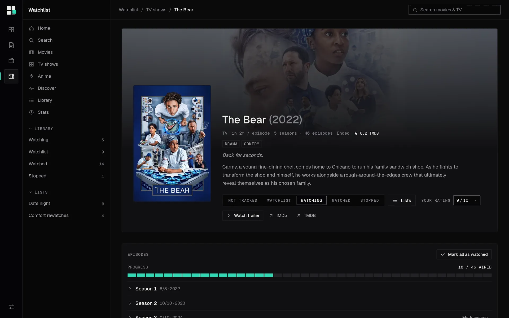</td>
    <td width="50%">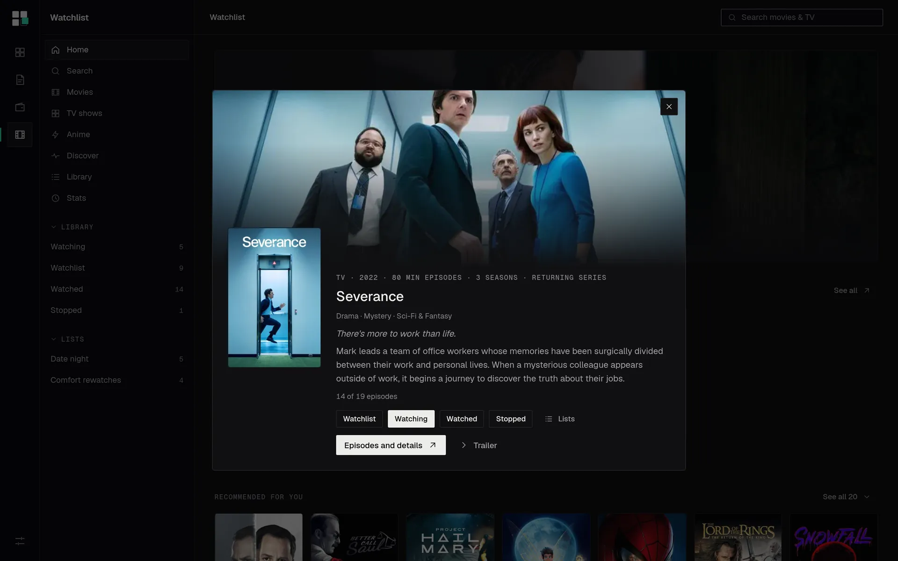</td>
  </tr>
  <tr>
    <td width="50%">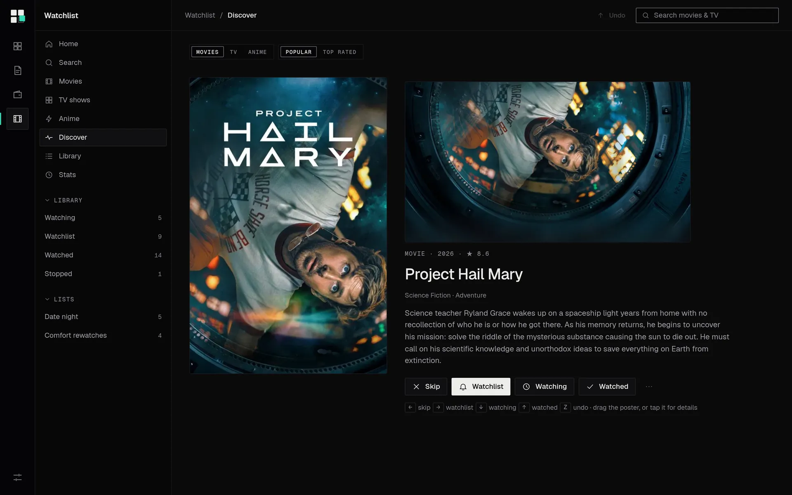</td>
    <td width="50%">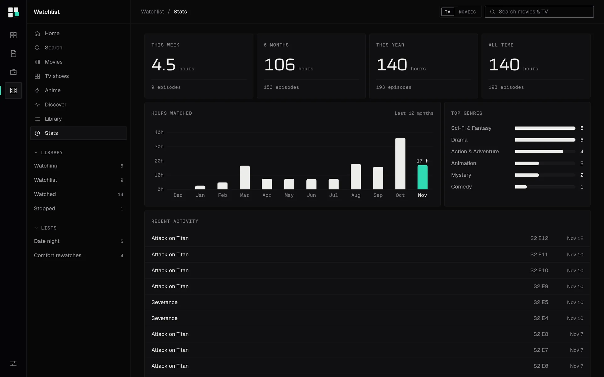</td>
  </tr>
</table>

## Everywhere

### Themes

Dark, Light, Graphite and Paper are built in. Override the **accent**,
**shape** (square, machined, soft corners), **font**, **icon style** and
**density**, or upload a whole theme as a JSON file. Cortex checks text and
edge contrast against WCAG and tells you if a combination fails.

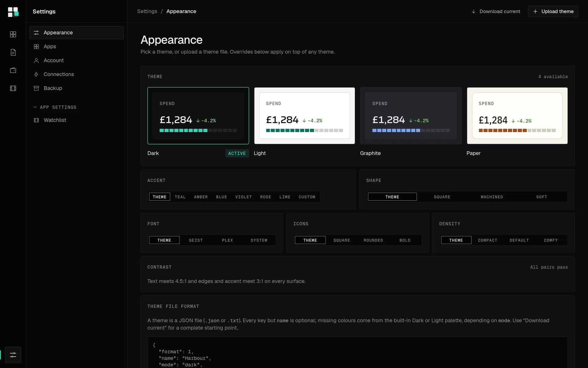

<details>
<summary><b>Theme file format</b></summary>

```json
{
  "format": 1,
  "name": "Harbour",
  "mode": "dark",
  "colors": { "bg-000": "#05070a", "ink-100": "#e8edf2", "accent": "#5ab0ff" },
  "shape": "machined",
  "fonts": "geist",
  "density": "default"
}
```

Every key but `name` is optional. Missing colours come from the built-in Dark
or Light palette. **Settings → Appearance → Download current** gives you a
complete starting point.

</details>

### On your phone

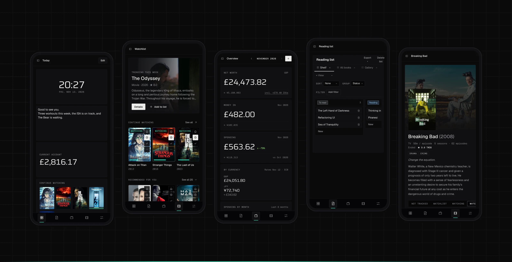

### Connections

Point a dashboard widget at any JSON API, such as Home Assistant, Homey, a
Docker socket proxy or your own scripts. Cortex calls it **from the server**,
so tokens never reach the browser. Tokens are stored encrypted with
`CORTEX_SECRET`. Hosted instances can block private-network addresses so
nobody can probe your LAN.

### Backup and restore

**Settings → Backup** downloads one file covering every app: pages, lists,
dashboards, accounts, transactions, budgets, rules, IOUs, watch history and
lists. Import it in **merge** or **replace** mode. Backups from Cortex v0 (the
older single-app version) import too, images included.

### Little things

- Switching apps returns you to where you were. Going back restores the list
  and scroll position you left.
- Breadcrumbs are links. Filters live in the address, so views can be
  bookmarked and shared.
- Numbers count up, titles type out, and panels arrive in sequence. All of it
  is short, and all of it switches off if your system asks for reduced motion.
- Works over plain HTTP on a LAN: no secure-context-only browser APIs.

## Self-hosting

Everything lives in the `/data` volume: the SQLite database, uploaded files,
and the generated secret. **Back up that volume**, or use the in-app backup.

| Variable | Default | What it does |
| --- | --- | --- |
| `CORTEX_URL` | unset | Public address when behind a reverse proxy or on HTTPS |
| `CORTEX_SECRET` | generated | Signs sessions and encrypts stored tokens. Kept in `/data/secret` if unset. **Back it up** |
| `DATABASE_URL` | SQLite | A Postgres connection string, for larger or hosted installs |
| `ALLOW_SIGNUP` | `false` | `true` lets anyone create an account (hosted mode) |
| `TMDB_API_KEY` | unset | Watchlist's TMDB key (or set it in the app) |
| `TMDB_REGION` | `GB` | Region for "In cinemas" and "Upcoming" |
| `FX_RATES_URL` | Frankfurter (ECB) | Exchange rates for multi-currency totals |
| `PROXY_PRIVATE_NETWORKS` | `allow` | `deny` blocks Connections and Plex from reaching private addresses |
| `MAX_UPLOAD_MB` | `25` | Largest file upload |
| `PORT` | `8080` | Port inside the container |

**Updating**: `docker pull ghcr.io/fergtato/cortex:latest` and recreate the
container. Database migrations run on start, for SQLite and Postgres alike.

The full guide covers configuration, backups, TrueNAS, the TMDB key and
moving from Cortex v0: **[docs/self-hosting.md](docs/self-hosting.md)**.

## How it's built

Cortex is a **modular monolith**: one repo, one Docker image, one database.
Each app is a module with a web half and a server half, registered in one
place. The shell gives every module a sidebar, pages, settings sections,
dashboard widgets and a slice of the backup.

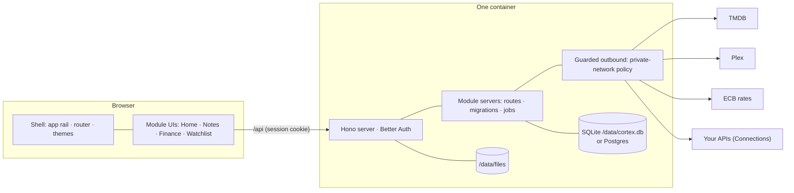

| Layer | Stack |
| --- | --- |
| Web | React 18, Vite 6, TanStack Query 5, Tiptap 2 (editor), Lucide icons, a hand-built design system (`@cortex/ui`) with themeable CSS variables |
| Server | Node 24, Hono 4, Better Auth, Zod, bundled to one file with esbuild |
| Data | Kysely 0.29 over SQLite (better-sqlite3) or Postgres (pg). One set of portable migrations for both |
| Packaging | npm workspaces (`apps/`, `packages/`, `modules/`), one multi-stage Alpine image, published to GHCR by GitHub Actions |

A few rules keep it portable and safe:
- **Every table has `user_id`.** Module code can only reach data through a
  per-user query helper.
- **Money is integer minor units**, never floats.
- **Only the server talks to third parties.** Keys and tokens never reach the
  browser, and outbound requests go through the private-network guard, which
  is enforced at the socket so DNS rebinding can't get round it.

More detail is in **[docs/v2-architecture.md](docs/v2-architecture.md)**, and
the rules for working on the code are in **[AGENTS.md](AGENTS.md)**.

## Development

```bash
git clone https://github.com/Fergtato/cortex && cd cortex
npm install
npm run dev          # API on :8080 (data in apps/server/data) + web on http://localhost:5173
npm run typecheck    # every workspace
npm run build        # typecheck, then bundle web + server
npm start            # run the built server (WEB_DIST=apps/web/dist serves the SPA)
```

Want something to look at straight away? Create an account, then fill it with
the demo data used for these screenshots. The Watchlist part needs a TMDB key:

```bash
node scripts/seed-demo.mjs http://localhost:8080 you@example.com your-password
```

```text
apps/web          the shell: rail, router, auth screens, settings
apps/server       Hono server: auth, migrations, files, connections, module routes
packages/ui       design system: components, tokens, themes, charts, motion
packages/core     module contract, router, API client, dialogs, backup helpers
packages/icons    Lucide catalogue + picker (lazy-loaded)
modules/home      dashboards and generic widgets
modules/notes     pages, lists, editor, Notes widgets
modules/finance   accounts, transactions, transfers, IOUs, CSV import
modules/watchlist TMDB client, library, stats, Discover, Plex import
```

**Adding an app** means a folder in `modules/` with a `CortexModule` (web) and
a `CortexServerModule` (server), one registry line each, and a line in the
Dockerfile. [docs/v2-architecture.md](docs/v2-architecture.md) walks through
it.

## Roadmap

- [x] Shell, accounts, themes, backups, Connections
- [x] Notes, Home dashboards, Finance, Watchlist
- [x] Bank CSV import, transfers, IOUs, multiple currencies
- [x] Plex import, Discover, stats
- [ ] **Recipes**: a cookbook with meal plans and shopping lists
- [ ] **Health**: workouts, sleep and weight, with Apple Health export import
- [ ] **Outfits**: a wardrobe and outfit planner
- [ ] Connectors: open-banking sync, wearables (Garmin, Oura, Fitbit, Withings)
- [ ] IMDb and TV Time importers for Watchlist
- [ ] A hosted version, from the same image

## Credits

- Film and TV data and images from **[TMDB](https://www.themoviedb.org)**.
  *This product uses the TMDB API but is not endorsed or certified by TMDB.*
- Exchange rates from the European Central Bank, via
  **[Frankfurter](https://frankfurter.dev)**.
- Icons by **[Lucide](https://lucide.dev)**. Typefaces: **Geist**, **Geist
  Mono** and **Saira**.
- Screenshots show demo data. Posters are © their respective owners.

## License

[MIT](LICENSE) © Fergus
